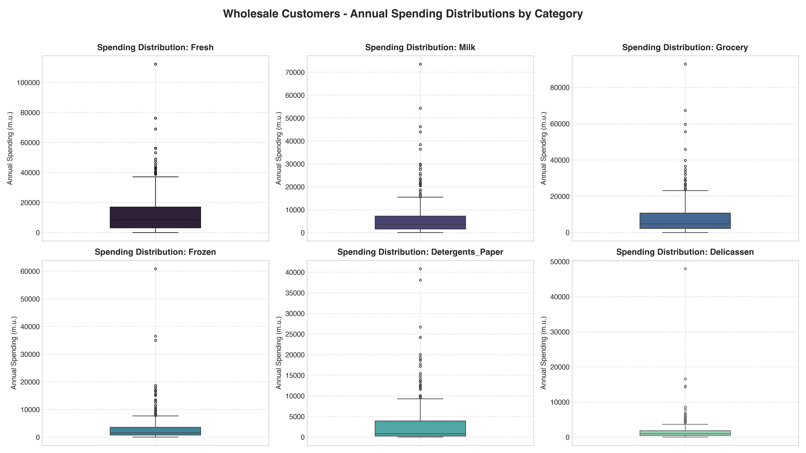
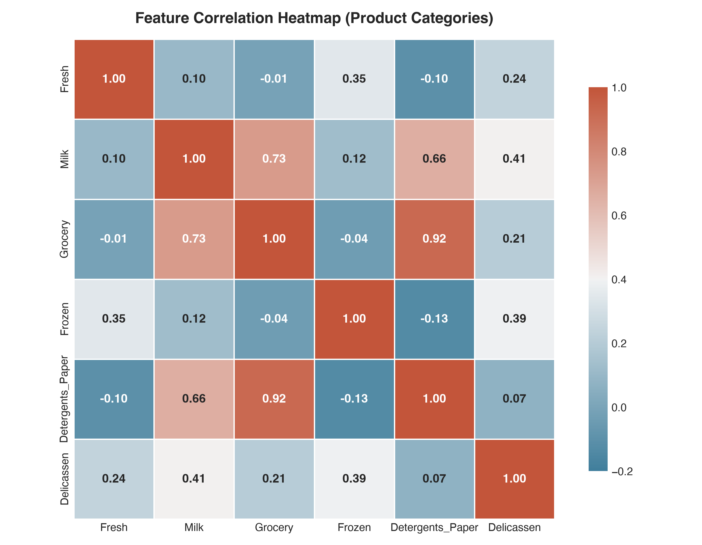
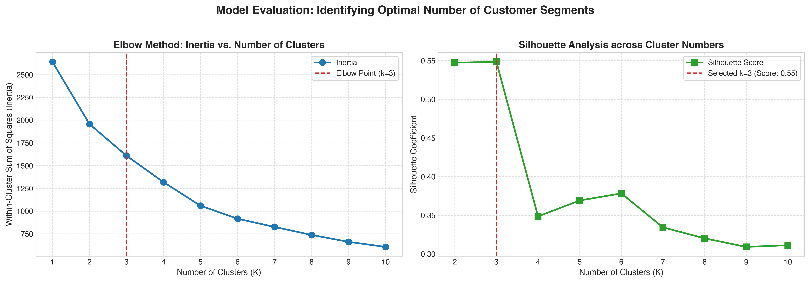
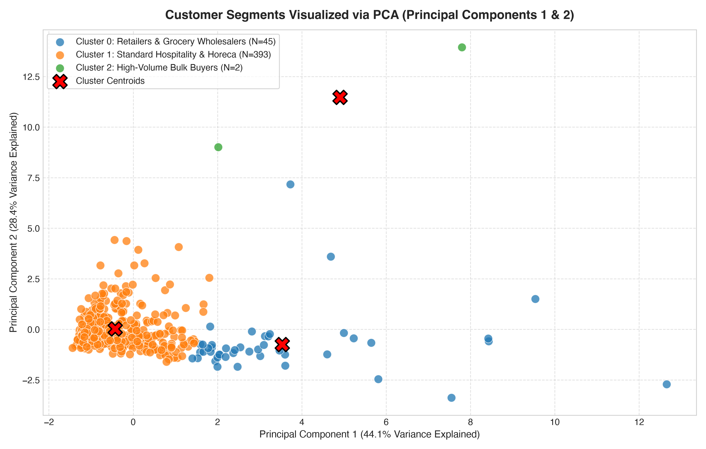
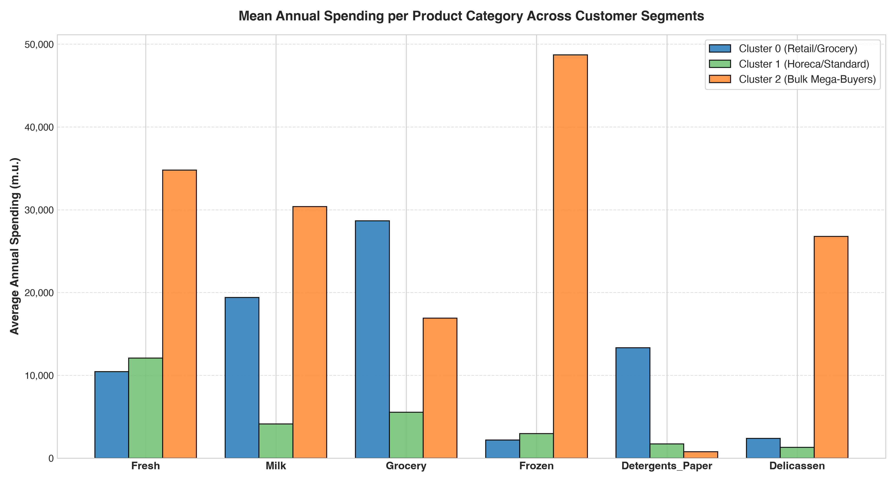
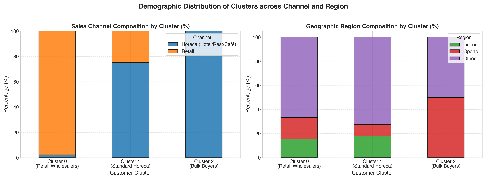

# 🛒 Wholesale Customer Segmentation

[](https://www.python.org/)
[](https://scikit-learn.org/)
[](https://jupyter.org/)
[](LICENSE)
[]()

> An end-to-end Unsupervised Machine Learning pipeline applying **K-Means Clustering** and **Principal Component Analysis (PCA)** to segment wholesale clients based on multi-category annual spending behaviors, translating data patterns into actionable B2B marketing and supply chain strategies.

---

## 📑 Table of Contents
1. [Project Overview](#-project-overview)
2. [Business Problem & Objectives](#-business-problem--objectives)
3. [Dataset Architecture](#-dataset-architecture)
4. [Machine Learning Workflow](#-machine-learning-workflow)
5. [Key Findings & Visualizations](#-key-findings--visualizations)
   - [Spending Distributions](#1-spending-distributions)
   - [Feature Correlations](#2-feature-correlations)
   - [Optimal Cluster Selection (Elbow & Silhouette)](#3-optimal-cluster-selection)
   - [PCA 2D Cluster Separation](#4-pca-2d-cluster-separation)
   - [Cluster Spending Comparison](#5-cluster-spending-comparison)
   - [Channel & Demographic Validation](#6-channel--demographic-validation)
6. [Customer Segment Profiles](#-customer-segment-profiles)
7. [Strategic Business & Marketing Recommendations](#-strategic-business--marketing-recommendations)
8. [Repository Structure](#-repository-structure)
9. [Installation & Quick Start](#-installation--quick-start)
10. [Technologies Used](#-technologies-used)
11. [Author & License](#-author--license)

---

## 🎯 Project Overview
In B2B wholesale distribution, treating all clients uniformly leads to misallocated sales resources, generic promotions, and sub-optimal inventory management. Wholesale distributors serve vastly different commercial profiles, ranging from small local bistros needing daily deliveries of fresh ingredients to supermarket chains purchasing non-perishables by the pallet.

This project delivers a complete **data-driven customer segmentation framework** using unsupervised machine learning. By analyzing the purchasing patterns of **440 wholesale clients** across six primary product lines, the system discovers organic customer cohorts, profiles their distinct operational needs, and provides leadership with concrete commercial recommendations.

---

## 💼 Business Problem & Objectives
- **Identify Core Buyer Personas:** Uncover natural groupings within client purchasing data without prior labels.
- **Optimize Marketing ROI:** Enable data-backed targeted campaigns, custom discount structures, and product bundle offers.
- **Supply Chain & Inventory Alignment:** Match delivery frequencies and warehouse priority to specific client segment demands.
- **Credit & Contract Personalization:** Guide payment term adjustments and contract structures tailored to client purchasing velocity.

---

## 📊 Dataset Architecture
The dataset is sourced from the **[UCI Machine Learning Repository: Wholesale Customers Data](https://archive.ics.uci.edu/ml/datasets/wholesale+customers)**. It comprises **440 client records** and **8 attributes** capturing annual expenditure in monetary units (m.u.).

| Feature | Type | Description |
| :--- | :--- | :--- |
| **`Channel`** | Categorical | Customer distribution channel: `1 = Horeca` (Hotel/Restaurant/Café), `2 = Retail` |
| **`Region`** | Categorical | Geographic region: `1 = Lisbon`, `2 = Oporto`, `3 = Other` |
| **`Fresh`** | Continuous | Annual expenditure on fresh produce (m.u.) |
| **`Milk`** | Continuous | Annual expenditure on dairy products (m.u.) |
| **`Grocery`** | Continuous | Annual expenditure on general grocery items (m.u.) |
| **`Frozen`** | Continuous | Annual expenditure on frozen food products (m.u.) |
| **`Detergents_Paper`** | Continuous | Annual expenditure on sanitary, cleaning, and paper supplies (m.u.) |
| **`Delicassen`** | Continuous | Annual expenditure on delicatessen / specialty food products (m.u.) |

---

## ⚙️ Machine Learning Workflow

```
┌─────────────────────────────────┐
│     Raw Wholesale Data (CSV)    │
└────────────────┬────────────────┘
                 │
                 ▼
┌─────────────────────────────────┐
│    Exploratory Data Analysis    │  <-- Distribution skewness, correlations, outliers
└────────────────┬────────────────┘
                 │
                 ▼
┌─────────────────────────────────┐
│ Data Preprocessing & Scaling    │  <-- Isolate continuous features, apply StandardScaler
└────────────────┬────────────────┘
                 │
                 ▼
┌─────────────────────────────────┐
│ Hyperparameter Optimization     │  <-- Evaluate K=2..10 via Elbow Method & Silhouette Analysis
└────────────────┬────────────────┘
                 │
                 ▼
┌─────────────────────────────────┐
│   K-Means Model (K=3) & PCA     │  <-- Fit centroids, project to 2D PCA space (72.5% variance)
└────────────────┬────────────────┘
                 │
                 ▼
┌─────────────────────────────────┐
│ Commercial Profiling & Strategy │  <-- Personas, cross-channel validation, marketing roadmap
└─────────────────────────────────┘
```

---

## 📈 Key Findings & Visualizations

### 1. Spending Distributions
The expenditure attributes exhibit substantial positive (right) skewness with long tails, reflecting a wide operational spectrum ranging from small local establishments to large-scale retail clients.

<p align="center">
  
</p>

---

### 2. Feature Correlations
A strong positive correlation exists between **`Grocery`**, **`Milk`**, and **`Detergents_Paper`** ($r > 0.65 - 0.92$), demonstrating that grocery retailers systematically restock household essentials and dairy goods concurrently.

<p align="center">
  
</p>

---

### 3. Optimal Cluster Selection
To identify the natural number of segments, we analyzed **Inertia** (Within-Cluster Sum of Squares) alongside the **Silhouette Score** across cluster counts $K \in [2, 10]$:
- The **Elbow Method** indicates a sharp deflection around $K = 3$.
- The **Silhouette Analysis** achieves its highest score of **0.5483** at $K = 3$, indicating optimal cluster cohesion and inter-cluster separation.

<p align="center">
  
</p>

---

### 4. PCA 2D Cluster Separation
Using Principal Component Analysis (PCA), the 6-dimensional spending space was projected onto 2 principal components, capturing **72.46%** of total dataset variance ($44.08\%$ on PC1, $28.38\%$ on PC2). The segments separate cleanly across the coordinate plane with well-defined centroids.

<p align="center">
  
</p>

---

### 5. Cluster Spending Comparison
Direct comparison of mean annual spending illustrates the core commercial behavior driving each segment:

<p align="center">
  
</p>

---

### 6. Channel & Demographic Validation
Cross-referencing the unsupervised clusters against ground-truth distribution channels (`Channel`) and geographical zones (`Region`) validates our behavioral findings:

<p align="center">
  
</p>

---

## 👥 Customer Segment Profiles

| Metric / Dimension | Cluster 0: Retailers & Supermarkets | Cluster 1: Hospitality & Foodservice | Cluster 2: Bulk Mega-Buyers |
| :--- | :--- | :--- | :--- |
| **Share of Portfolio** | **10.2%** (45 clients) | **89.3%** (393 clients) | **0.5%** (2 clients) |
| **Dominant Channel** | **97.8% Retail Stores** | **75.1% HoReCa (Hotels/Rest/Café)** | **100% HoReCa Wholesale** |
| **Primary Expenditures** | **Grocery** (~28,656 m.u.)<br>**Milk** (~19,386 m.u.)<br>**Detergents_Paper** (~13,328 m.u.) | **Fresh** (~12,063 m.u.)<br>**Grocery** (~5,535 m.u.)<br>**Milk** (~4,115 m.u.) | **Frozen** (~48,702 m.u.)<br>**Fresh** (~34,782 m.u.)<br>**Delicassen** (~26,776 m.u.) |
| **Order Frequency** | Bi-weekly / Weekly bulk replenishment | Daily / Multi-weekly just-in-time orders | Continuous high-volume corporate contracts |
| **Operational Focus** | High shelf-life goods, household sanitizers | Fresh perishable culinary supplies | Heavy cold-chain inventory & catering scale |

---

## 💡 Strategic Business & Marketing Recommendations

```
┌────────────────────────────────────────────────────────────────────────┐
│                        COMMERCIAL ACTION PLAN                          │
├─────────────────────────┬──────────────────────────┬───────────────────┤
│    Cluster 0: Retail    │    Cluster 1: HoReCa     │  Cluster 2: Bulk  │
├─────────────────────────┼──────────────────────────┼───────────────────┤
│ • Cross-category promo  │ • Morning delivery slots │ • VIP SLA support │
│ • Automated restocking  │ • Weekly fresh bundles   │ • Tiered rebates  │
│ • Net-60 trade terms    │ • Mobile ordering app    │ • Cold-chain slot │
└─────────────────────────┴──────────────────────────┴───────────────────┘
```

### 1. Cluster 0: Retailers & Supermarket Chains
- **Cross-Category Volume Bundling:** Incentivize higher basket sizes by offering bundled discounts on complementary lines (e.g., detergents & paper goods combined with dry groceries).
- **Vendor-Managed Inventory (VMI):** Integrate directly with supermarket inventory software for automated scheduled replenishment.
- **Extended Trade Credit:** Offer flexible Net-30 or Net-60 trade payment terms to cultivate long-term exclusivity.

### 2. Cluster 1: Hospitality & Foodservice (HoReCa)
- **Just-In-Time (JIT) Delivery Windows:** Establish reliable early-morning deliveries to ensure restaurant kitchens receive peak fresh produce prior to prep shifts.
- **Curated Culinary Bundles:** Launch seasonal recipe ingredient packs (fresh meats, seasonal organic vegetables, specialty dairy) with dynamic weekly pricing.
- **Digital Ordering Portal:** Deploy a frictionless mobile app for head chefs and managers to place rapid one-touch late-night orders.

### 3. Cluster 2: Mega High-Volume Bulk Buyers
- **VIP Logistics & Dedicated Cold-Chain Slots:** Allocate priority warehouse picking and refrigerated fleet routing to guarantee zero service disruption.
- **Enterprise Contract Pricing:** Negotiate customized annual rebate structures tied to cumulative volume milestones.
- **Executive Account Sponsorship:** Conduct quarterly executive reviews with senior leadership to guarantee 100% client retention.

---

## 📁 Repository Structure

```
wholesale-customer-segmentation/
├── customer_segmentation.ipynb   # Fully annotated Jupyter Notebook with executed outputs
├── data/
│   ├── Wholesale_customers_data.csv   # Raw UCI dataset (offline reproducible)
│   └── segmented_customers.csv        # Segmented output dataset with cluster & PCA labels
├── figures/
│   ├── 01_spending_distributions.png       # Category-wise boxplot spending distributions
│   ├── 02_correlation_heatmap.png          # Spending attribute correlation matrix
│   ├── 03_elbow_silhouette_analysis.png    # K-Means Elbow & Silhouette evaluation
│   ├── 04_pca_clusters_2d.png              # 2D PCA customer segment projection
│   ├── 05_cluster_spending_comparison.png  # Mean spending breakdown by category & cluster
│   └── 06_channel_region_breakdown.png     # Channel and geographic composition
├── src/
│   ├── segmentation.py           # Standalone production pipeline script (CLI executable)
│   └── generate_visuals.py       # Automated high-resolution figure generator
├── .gitignore                    # Clean data science Git ignore rules
├── requirements.txt              # Production dependency specifications
└── README.md                     # Comprehensive project documentation
```

---

## 🚀 Installation & Quick Start

### 1. Clone the Repository
```bash
git clone https://github.com/BehruzMaxmudov1203/wholesale-customer-segmentation.git
cd wholesale-customer-segmentation
```

### 2. Set Up Virtual Environment (Recommended)
```bash
python3 -m venv venv
source venv/bin/activate  # On Windows: venv\Scripts\activate
```

### 3. Install Dependencies
```bash
pip install -r requirements.txt
```

### 4. Run the Pipeline CLI
Execute the end-to-end unsupervised pipeline via command-line:
```bash
python src/segmentation.py --clusters 3
```

### 5. Launch the Jupyter Notebook
Open and inspect the interactive, fully annotated analysis:
```bash
jupyter notebook customer_segmentation.ipynb
```

---

## 🛠️ Technologies Used
- **Language:** Python 3.12+
- **Machine Learning:** `scikit-learn` (KMeans, StandardScaler, PCA, silhouette_score)
- **Data Manipulation:** `pandas`, `numpy`
- **Visualization:** `matplotlib`, `seaborn`
- **Notebook Environment:** `Jupyter`, `IPython`

---

## 👤 Author & License
- **Author:** Behruz Mahmudov ([@BehruzMaxmudov1203](https://github.com/BehruzMaxmudov1203))
- **Repository:** [wholesale-customer-segmentation](https://github.com/BehruzMaxmudov1203/wholesale-customer-segmentation)
- **License:** Distributed under the [MIT License](LICENSE).
